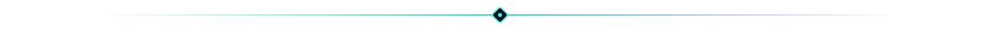
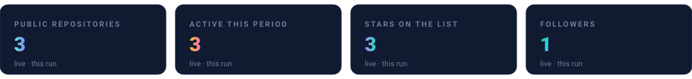
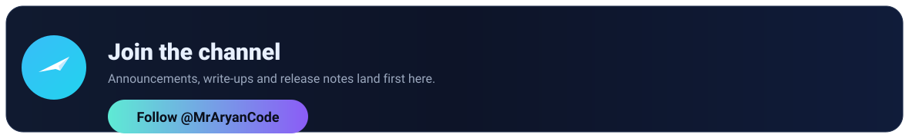

  

I'm Aryan Miri, a full-stack developer based in Tehran. I work across web, backend and mobile, and I publish my open-source work here. The first public project is certway, a command-line tool written in Rust.

**Stack:** TypeScript, Python, Go, Rust · React, SolidJS, Svelte · Node.js, .NET · Flutter

## Working with me

- Open to remote full-stack roles, full-time or contract.
- Based in Tehran (UTC+03:30).
- Email: [mraryanmiri@gmail.com](mailto:mraryanmiri@gmail.com) · Telegram: [@aryan_61_04](https://t.me/aryan_61_04)

## In numbers

## Follow along

Questions about a specific project: open an issue in its repository. Anything else: message me on [Telegram](https://t.me/aryan_61_04).

  <b>MrAryanCode</b>

